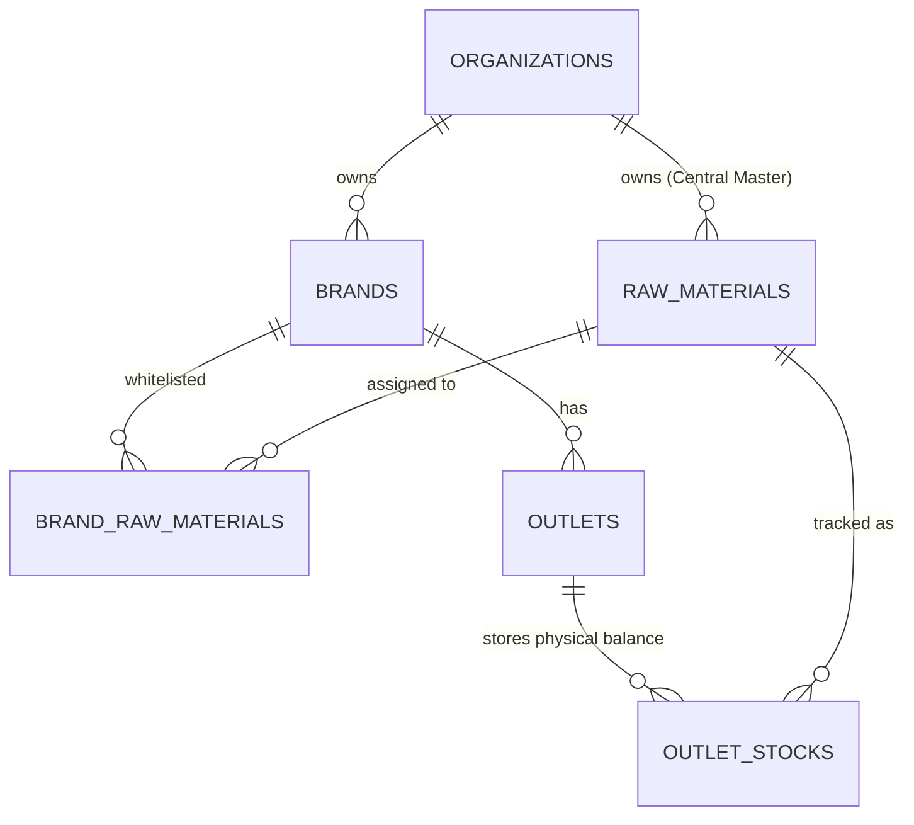

# Master Data & UoM Architecture Knowledge: Foundation of FnB ERP & Supply Chain

Dokumen ini adalah **Global Knowledge** resmi untuk arsitektur **Master Data & Unit of Measurement (UoM)** pada Hanjo ERP & POS Backend. Dokumen ini mendokumentasikan alasan perancangan (*design rationale*), hierarki konversi satuan, pemisahan scope multi-tenant bahan baku, serta alur operasional di lapangan agar developer dan AI agent di masa mendatang memiliki konteks yang utuh.

---

## 1. Filosofi Arsitektur: Mengapa Pendekatan Bottom-Up?

Dalam pengembangan software FnB POS & ERP, terdapat dua pendekatan mendasar:

```text
[Pendekatan Top-Down (Umum di POS Retail Biasa)]
Menu Produk ➔ Kasir POS ➔ (Baru Tambal Modul Stok Nanti) 
* Masalah: Hutang teknis tinggi, skema database harus di-refactor berkali-kali saat fitur resep & HPP ditambahkan.

[Pendekatan Bottom-Up (Enterprise ERP FnB - Pilihan Hanjo)]
1. Master Satuan (UoM) & Konversi
   └── 2. Master Bahan Baku (Raw Materials) & Vendor
         └── 3. Master Menu & Modifiers (Catalog)
               └── 4. Resep / Bill of Materials (BOM) & Kalkulasi HPP Real-time
                     └── 5. Order & POS Engine (Potong Stok Otomatis)
```

### Mengapa Hanjo ERP Memilih Bottom-Up?
1. **Integritas Relasional Database**: 
   Sebuah resep menu (`recipe_items`) membutuhkan foreign key langsung ke bahan baku (`raw_material_id`) dan satuan resep (`uom_id`). Merancang UoM dan Bahan Baku terlebih dahulu memastikan relasi foreign key bersih sejak migrasi pertama tanpa kolom *nullable* sementara.
2. **Kalkulasi HPP (Food Cost / COGS) Otomatis**:
   Bisnis FnB hidup atau mati dari margin laba kotor (*Gross Margin*). Dengan struktur Bottom-Up, saat pemilik resto menetapkan harga jual menu, sistem langsung dapat menghitung:
   $$\text{HPP (Food Cost)} = \sum (\text{Harga Satuan Bahan Baku} \times \text{Takaran Resep})$$
   $$\text{Gross Profit} = \text{Harga Jual} - \text{HPP}$$
3. **Pencatatan Bahan Kemasan (Packaging Materials)**:
   Di industri FnB, cup plastik, tutup, sedotan, paper bag, dan lunch box adalah bahan baku yang memotong stok. Transaksi *Takeaway* vs *Dine-in* memiliki resep packaging yang berbeda.

---

## 2. Multi-Tenant Brand Scoping untuk Bahan Baku

### Permasalahan Bisnis:
Holding company (`Organization`) menaungi beberapa merek (*multi-brand*):
* **Brand A** (*Daily Coffee*): Menggunakan Susu Segar Merek X.
* **Brand B** (*Senja Roastery*): Menggunakan Susu Segar Merek X yang sama.
* **Brand C** (*Dua Sudut Tea House*): **Tidak menggunakan** Susu Segar Merek X (spesialis teh murni).

### Keputusan Solusi: Central Master + Brand Whitelist



1. **Master Terpusat di Level Organization (Tier 1)**:
   Entitas `raw_materials` berada di level `organization_id`. Hal ini memungkinkan:
   - **Central Procurement**: Holding menegosiasi pembelian skala besar (misal 10.000 karton susu) langsung ke distributor untuk mendapatkan diskon maksimal bagi seluruh brand.
   - **Gudang Pusat (Central Warehouse)**: Memungkinkan gudang holding menyimpan 1 jenis SKU bahan dan mendistribusikannya ke cabang Brand A maupun Brand B melalui *Stock Transfer*.
2. **Whitelist Per Brand (`brand_raw_materials`)**:
   Untuk mencegah staf Brand C salah memilih bahan baku milik brand lain saat membuat resep menu, dibuat tabel pivot pemetaan:
   - Brand A ➔ Susu Merek X ✅
   - Brand B ➔ Susu Merek X ✅
   - Brand C ➔ *Tidak terdaftar* ❌ (Dropdown bahan baku di CMS Brand C tidak menampilkan Susu Merek X).
3. **Barang Universal (`is_all_brands = TRUE`)**:
   Untuk bahan yang dipakai oleh semua brand tanpa terkecuali (seperti *Kantong Plastik, Tissue, Sedotan Kertas*), flag `is_all_brands` bernilai `TRUE` sehingga otomatis aktif di semua brand tanpa perlu didaftarkan satu per satu di tabel pivot.

---

## 3. Konsep Satuan (Unit of Measurement / UoM)

### 3.1 The 3-Tier UoM Layers (Hierarki Satuan Lapangan)

Satu jenis bahan baku di FnB selalu memiliki 3 lapisan satuan:

```text
[1. Purchase UoM]      Satuan Pembelian Faktur: "KARTON / BAL" (isi 12 kotak)
        ↓  (Faktor Konversi Kemasan)
[2. Storage UoM]       Satuan Simpan & Opname Fisik: "KOTAK / BOTOL" (isi 1.000 ml)
        ↓  (Faktor Konversi Resep)
[3. Base / Recipe UoM] Satuan Racik Barista / Chef: "ML / GRAM / PCS" (150 ml per cup)
```

### 3.2 Aturan Emas Database (The Golden Rule of Inventory Balance)

> **"Di dalam database, seluruh saldo stok fisik SELALU disimpan dalam satuan Base UoM (satuan terkecil)!"**

* **Alasan Teknis**: 
  Jika stok disimpan dalam satuan majemuk seperti *karton*, ketika barista menggunakan `150 ml`, database harus mencatat pengurangan sebesar `0.0125 karton`. Akumulasi pengurangan angka desimal koma panjang di database relasional akan memicu selisih pembulatan (*floating point rounding drift*).
* **Solusi**: 
  - Pembelian 1 Karton Susu ($12 \times 1.000\text{ ml}$) masuk ke database sebagai **`+12.000 ml`**.
  - Penjualan 1 Cup Latte memotong stok sebesar **`-150 ml`**.
  - Saldo stok di database selalu berupa angka integer/desimal presisi murni.
  - Saat ditampilkan di UI pengguna, sistem mengonversikannya kembali: *"9 Kotak 850 ml"* atau *"0.98 Karton"*.

---

## 4. Dua Layer Konversi Satuan (The Two-Tier Conversion Model)

Hanjo ERP memisahkan konversi menjadi dua lapisan:

| Layer Konversi | Lokasi Tabel | Cakupan / Karakteristik | Contoh |
| :--- | :--- | :--- | :--- |
| **Layer 1: Metrik Standar Global** | `uom_conversions` (Modul `uom`) | Universal, pasti, berlaku untuk bahan apa saja. Tidak bergantung pada merek barang. | $1\text{ kg} = 1.000\text{ g}$<br>$1\text{ liter} = 1.000\text{ ml}$ |
| **Layer 2: Kemasan Spesifik Bahan** | `raw_material_uom_conversions` (Modul `raw_material`) | Berbeda-beda tergantung spesifikasi pabrik/supplier untuk SKU tertentu. | 1 Karton Susu = $12.000\text{ ml}$<br>1 Botol Sirup = $750\text{ ml}$<br>1 Slop Cup = $50\text{ pcs}$ |

---

## 5. Alur Siklus Hidup Operasional (Lifecycle Workflows)

Kapan sistem memicu eksekusi `uom_conversion`?

```mermaid
flowchart TD
    subgraph Flow1 ["Alur 1: Kalkulasi HPP Resep"]
        P1["Beli Biji Kopi: Rp 200.000 / 1 kg"] --> C1["uom_conversions: 1 kg = 1000 g"]
        C1 --> H1["Harga per gram = Rp 200"]
        H1 --> R1["Resep Espresso 18g: HPP = Rp 3.600"]
    end

    subgraph Flow2 ["Alur 2: Penerimaan Barang (PO Inbound)"]
        P2["Surat Jalan Terima: 5 Karton Susu"] --> C2["raw_material_conversions: 1 ctn = 12.000 ml"]
        C2 --> S2["Stok Database bertambah: +60.000 ml"]
    end

    subgraph Flow3 ["Alur 3: Stock Opname Lapangan"]
        P3["Barista Input Fisik: 3 Kotak + 400 ml"] --> C3["Konversi: (3 x 1000 ml) + 400 ml"]
        C3 --> S3["Total Fisik = 3.400 ml vs DB 3.500 ml -> Varian: -100 ml"]
    end

    subgraph Flow4 ["Alur 4: Barang Rusak / Tumpah (Waste)"]
        P4["Lapor Tumpah: 1 Botol Sirup"] --> C4["Konversi: 1 btl = 750 ml"]
        C4 --> S4["Stok Database berkurang: -750 ml"]
    end
```



---

## 6. Blueprint Skema Database PostgreSQL (DDL)

```sql
-- ========================================================
-- 1. TABEL UOMS (Master Satuan)
-- ========================================================
CREATE TABLE uoms (
    id UUID PRIMARY KEY DEFAULT gen_random_uuid(),
    organization_id UUID REFERENCES organizations(id) ON DELETE CASCADE, -- NULL untuk satuan standar global
    name VARCHAR(100) NOT NULL,                                          -- "Gram", "Milliliter", "Piece"
    symbol VARCHAR(20) NOT NULL,                                         -- "g", "ml", "pcs", "ctn"
    category VARCHAR(50) NOT NULL,                                       -- 'WEIGHT', 'VOLUME', 'UNIT'
    decimal_places SMALLINT NOT NULL DEFAULT 0,                          -- 0 untuk pcs, 2 untuk g/ml
    is_system BOOLEAN NOT NULL DEFAULT FALSE,                            -- TRUE untuk satuan bawaan sistem
    status VARCHAR(50) NOT NULL DEFAULT 'ACTIVE',                        -- 'ACTIVE', 'INACTIVE'
    created_at TIMESTAMPTZ NOT NULL DEFAULT NOW(),
    updated_at TIMESTAMPTZ NOT NULL DEFAULT NOW(),
    deleted_at TIMESTAMPTZ
);

-- Partial Unique Indexes
CREATE UNIQUE INDEX idx_uoms_system_symbol 
    ON uoms(symbol) 
    WHERE organization_id IS NULL AND deleted_at IS NULL;

CREATE UNIQUE INDEX idx_uoms_org_symbol 
    ON uoms(organization_id, symbol) 
    WHERE organization_id IS NOT NULL AND deleted_at IS NULL;

CREATE INDEX idx_uoms_org_category ON uoms(organization_id, category) WHERE deleted_at IS NULL;
CREATE INDEX idx_uoms_status ON uoms(status) WHERE deleted_at IS NULL;


-- ========================================================
-- 2. TABEL UOM_CONVERSIONS (Konversi Metrik Global)
-- ========================================================
CREATE TABLE uom_conversions (
    id UUID PRIMARY KEY DEFAULT gen_random_uuid(),
    organization_id UUID REFERENCES organizations(id) ON DELETE CASCADE, -- NULL untuk standar global
    from_uom_id UUID NOT NULL REFERENCES uoms(id) ON DELETE CASCADE,
    to_uom_id UUID NOT NULL REFERENCES uoms(id) ON DELETE CASCADE,
    factor NUMERIC(15, 6) NOT NULL,                                      -- Misal kg -> g factor = 1000.000000
    is_system BOOLEAN NOT NULL DEFAULT FALSE,
    created_at TIMESTAMPTZ NOT NULL DEFAULT NOW(),
    updated_at TIMESTAMPTZ NOT NULL DEFAULT NOW(),
    CONSTRAINT uq_uom_conversions_pair UNIQUE(from_uom_id, to_uom_id)
);

CREATE INDEX idx_uom_conversions_lookup ON uom_conversions(from_uom_id, to_uom_id);
```

---

## 7. Standar Satuan Bawaan Sistem (System Default Seeders)

Ketika instansiasi sistem dijalankan, baris data berikut di-seed otomatis dengan `is_system = TRUE` dan `organization_id = NULL`:

| Category | Name | Symbol | Decimals | Deskripsi Operasional |
| :--- | :--- | :--- | :---: | :--- |
| `VOLUME` | Milliliter | `ml` | 2 | Base UoM untuk resep cairan / sirup / susu |
| `VOLUME` | Liter | `l` | 2 | Satuan simpan & pembelian cairan |
| `WEIGHT` | Gram | `g` | 2 | Base UoM untuk biji kopi, daging, bumbu, saus |
| `WEIGHT` | Kilogram | `kg` | 3 | Satuan pembelian grosir bahan kering |
| `UNIT` | Piece | `pcs` | 0 | Base UoM untuk cup, sedotan, tutup, napkin |
| `UNIT` | Pack | `pack` | 0 | Satuan simpan keju, sachet, teh kantong |
| `UNIT` | Bottle | `btl` | 0 | Satuan simpan sirup botol, soda kaleng |
| `UNIT` | Box / Carton | `ctn` | 0 | Satuan pembelian dus besar dari supplier |

---

## 8. Panduan Integrasi Clean Architecture

1. **Domain Layer Independence**:
   Modul `internal/modules/uom` mengekspos `domain.UoMSummary` yang ringan agar modul lain (`raw_material`, `catalog`, `recipe`) dapat menyematkan metadata satuan tanpa kopling langsung.
2. **Lookup Endpoint Protection**:
   Mengikuti aturan [.agents/rules/rbac-lookup.md](file:///Users/dystopia/projects/hanjo-erp/hanjo-backend/.agents/rules/rbac-lookup.md):
   - `GET /api/v1/uoms/lookup` didefinisikan **sebelum** `GET /api/v1/uoms/:id` di Fiber router.
   - Endpoint lookup mengembalikan `id, name, symbol, category, decimal_places` dengan filter `status = 'ACTIVE'` untuk konsumsi dropdown formulir frontend.
